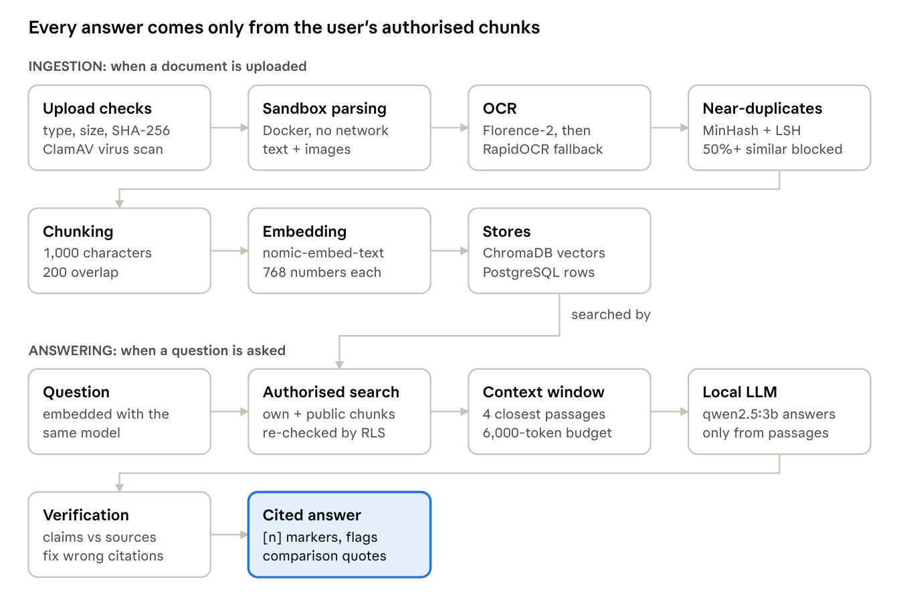

# Aether Link AI Pipeline and Models

Status: 17 November 2026. Shared, editable version: the "Aether Link AI Pipeline and Models" doc (PDF copy kept by the lead).

## Summary

Aether Link answers questions from a user's own documents using only local AI models: four models run on the team's own machine through Ollama, Hugging Face and ONNX, and no document text is sent to an outside AI service. A document is checked, parsed in a sandbox, read (including text inside images), split into chunks and stored as meaning-vectors. A question retrieves the closest authorised chunks, a small local language model writes an answer from them with numbered citations, and every statement is checked against its source before the answer is returned.

On the project's evaluation set (53 questions over 12 policy documents) the pipeline answers 94% of questions correctly, cites the right passage 96% of the time, refuses all 8 unanswerable questions without inventing anything, and answers in a median of 2.8 seconds on a CPU-only server.

## Models

Four models run today, all locally on CPU; a fifth (the re-ranker) is planned. The two Ollama models run on the host; the OCR models run inside the backend container.

| Model | Role | Size | Runs in | Why this one |
| --- | --- | --- | --- | --- |
| `nomic-embed-text` v1.5 | Embeddings: turns chunks and questions into 768-number meaning-vectors | ~137M parameters | Ollama (host) | Strong retrieval quality for its size; fast on CPU |
| `qwen2.5:3b` | Answer model: writes grounded answers with [n] citations | 3B parameters | Ollama (host) | Answers in 1-8 s on CPU. `qwen3:4b` reasoned for ~1,200 tokens and ignored the no-thinking switch: ~5 minutes per answer |
| Florence-2-base | Primary OCR: reads text inside images in PDF/DOCX | 0.23B parameters | Backend container (transformers) | MIT licence; 99.6% / 99.9% character accuracy (clean / low quality); cached in `hf_cache`, works offline |
| RapidOCR (PaddleOCR detection + recognition, ONNX) | Fallback OCR (AL-283) | ~15 MB of models | Backend container (onnxruntime) | Models ship in the package, no run-time download; loads in 0.5 s; 97.9% / 96.7% accuracy |
| `bge-reranker-v2-m3` | Re-ranker (planned, FR-026) | 568M parameters | Not built yet | Configured for the hybrid search work |

Changing the embedding model requires re-indexing every document; each chunk records its `embedding_model`.

## Pipeline overview



Ingestion runs once per uploaded document; answering runs for every question and only ever reads the chunks the asking user is allowed to see. Both flows share the stores: ChromaDB for meaning search and PostgreSQL `document_chunks` for keyword search and citations.

## Ingestion: from upload to searchable chunks

Any failed step marks the document `failed` with a readable reason; nothing half-processed becomes searchable.

1. **Upload checks.** PDF, DOCX and TXT up to 25 MB; double extensions and spoofed types rejected; SHA-256 blocks exact duplicates (per user for private, global for public); ClamAV scans every file and quarantines infected ones.
2. **Sandbox parsing** (`document_parser.py`, image `rag-parser-sandbox`). Throwaway Docker container: no network, read-only, unprivileged, no capabilities, 512 MB, 1 CPU, 64 processes, 60 s. Layout mode returns text per page plus every image with page and position. Never parsed outside the sandbox.
3. **OCR** (`ocr_engines.py`, `document_images.py`). Florence-2 reads images in batches of 4. An image it cannot read, reads empty, or reads with confidence below 0.5 goes to RapidOCR; the better result is kept. 30 s OCR budget per document; leftover images are skipped and logged (`ocr_image_skipped`).
4. **Merge** (`ocr_merge.py`). Image text is placed where the image sat on the page.
5. **Near-duplicate check** (`near_duplicate.py`). 3-word shingles, 128-value MinHash, LSH with 42 bands of 3; at least 50% similar to the user's own or a public document is rejected; other users' private documents are never compared.
6. **Chunking** (`chunking.py`). About 1,000 characters with 200 overlap (a token-based, section-aware chunker is merged but not yet wired in).
7. **Embedding** (`embedding.py`). `nomic-embed-text`, batches of 32, retries, 768-dimension check.
8. **Storage.** ChromaDB (`user_<id>_private` or `public_knowledge`, cosine) and, with PR #49, PostgreSQL `document_chunks` (keyword index, OCR fields). Status becomes `indexed`.

## Question answering: from question to cited answer

`POST /api/v1/chat/ask` (`api/v1/chat.py`, `services/qa.py`), JSON or Server-Sent Events. Contract: `docs/API_CHAT.md`.

1. **Retrieval** with `query_authorized_chunks`: only the caller's private and public chunks, re-checked against PostgreSQL row-level security. Comparison questions fetch 30 candidates and keep the top 3 passages per document (up to 4 documents).
2. **Relevance and evidence checks.** Drop passages farther than 0.55 or more than 0.12 behind the best match; call the model only with 2 relevant passages or 1 strong one (≤ 0.5); otherwise "not enough information" without calling the model.
3. **Injection cleaning.** Instruction-like sentences are removed from passages; `injection_detected` is set.
4. **Context window.** Up to 4 closest passages within a 6,000-token budget, cut at sentence ends.
5. **Grounded prompt + local model.** `qwen2.5:3b` answers only from numbered passages inside `<context>`, cites [n], treats passages as data, answers `INSUFFICIENT_EVIDENCE` if the answer is absent. Comparison prompts label Document A, B; users see real names.
6. **Verification.** Every number must appear in the cited passage; meaning must match (≥ 0.78) with a polarity check. Wrong citations are re-cited; unsupported statements removed and the answer marked uncertain; invented citations dropped; answers leaking the system prompt withheld.
7. **Comparison analysis.** Matching statements across documents classified agree / differ / contradict with quotes; wrong agreement claims removed.
8. **Fallbacks when the model declines.** Comparisons answered from the analysis with quotes; other questions answered by quoting the closest source sentence if it matches the question at ≥ 0.65.
9. **Response.** Answer, cited sources, checked claims, flags `insufficient`, `uncertain` (+ reason), `injection_detected`, `comparison`.

## Security and isolation

| Where | Protection |
| --- | --- |
| Models | All local; document text never leaves the machine; models load from disk (works offline) |
| Vector store | Private ChromaDB collection per user; owner + visibility filter on every private read |
| Retrieval | Every candidate chunk re-checked against PostgreSQL RLS before the prompt |
| PostgreSQL chunks | Forced RLS mirroring `documents`; insert only for your own document with the same visibility; no updates |
| Prompt | `<context>` data block; instruction-like sentences removed; breakout tags neutralised |
| Output | Citations only to authorised passages; system-prompt leaks withheld; no `user_id` in responses |
| Files | Parsing only in the sandbox; backend (OCR) container limited to 4 CPUs / 4 GB |

## Configuration (`backend/app/core/config.py`)

| Setting | Default | Calibrated from |
| --- | --- | --- |
| `LLM_MODEL` | `qwen2.5:3b` | qwen3:4b ~5 min per answer on CPU |
| `EMBEDDING_MODEL` | `nomic-embed-text` | |
| `CHUNK_SIZE` / `CHUNK_OVERLAP` | 1000 / 200 chars | |
| `QA_RETRIEVAL_K` | 4 | 8 passages: ~10 s slower, false refusals |
| `QA_MAX_DISTANCE` | 0.55 | Correct chunks 0.12-0.45; unanswerable best 0.40-0.56 |
| `QA_RELATIVE_MARGIN` | 0.12 | Removes distractors |
| `QA_MAX_CONTEXT_TOKENS` | 6000 | |
| `QA_MIN_EVIDENCE_CHUNKS` / `QA_STRONG_EVIDENCE_DISTANCE` | 2 / 0.5 | FR-048 |
| `QA_CLAIM_MIN_SUPPORT` | 0.78 | Faithful 0.88-0.90; plausible-unsupported 0.71 |
| `QA_SAME_TOPIC_SIMILARITY` / `QA_AGREE_SIMILARITY` | 0.68 / 0.83 | Opposite rule 0.72; reworded fact 0.86; other point 0.62 |
| `QA_QUOTE_FALLBACK_MIN` | 0.65 | Answerable ≥ 0.636; unanswerable ≤ 0.612 |
| `QA_UNCERTAIN_MAX_DISTANCE` | 0.5 | Correct single-passage answers 0.64-0.72 |
| `OCR_ENABLED` / `OCR_FALLBACK_ENABLED` | true / true | |
| `OCR_FALLBACK_MIN_CONFIDENCE` | 0.5 | |
| `OCR_DOCUMENT_BUDGET_SECONDS` / `OCR_BATCH_SIZE` | 30 / 4 | Florence-2 ~4 s per document |
| `BACKEND_CPUS` / `BACKEND_MEMORY` | 4 / 4g | Peak 1.55 GB during OCR |

## Evaluation results

| Measure | Standard RAG | Aether Link pipeline |
| --- | --- | --- |
| Correct answer | 91% | 94% |
| Citation points to the right passage | 83% | 96% |
| False refusals | 9% | 2% |
| Unanswerable refused / hallucinated | 100% / 0% | 100% / 0% |
| Answer time median / P95 (CPU) | 6.4 s / 8.5 s | 2.8 s / 6.7 s |

Retrieval: Hit@1 0.91, MRR 0.94, R@5 1.00, 45 ms. Comparisons 5/5. Follow-ups 8/10 alone, 9/10 with history. OCR: Florence-2 99.6% / 99.9%, RapidOCR 97.9% / 96.7% (clean / low quality). Details: `docs/EVALUATION.md`, `docs/OCR_ACCURACY.md`.

## How to use it

```bash
ollama pull nomic-embed-text
ollama pull qwen2.5:3b
docker build -t rag-parser-sandbox:latest docker/parser
docker compose up -d --build

curl -s https://localhost/api/v1/chat/ask -H "Authorization: Bearer $TOKEN" \
  -H "Content-Type: application/json" \
  -d '{"question": "How quickly must a data incident be reported?"}'

python -m backend.evaluation.run                        # full evaluation -> docs/EVALUATION.md
python backend/tests/fixtures/ocr/evaluate.py           # Florence-2 OCR accuracy
python backend/tests/fixtures/ocr/evaluate_fallback.py  # RapidOCR accuracy
```

## Known limitations and next steps

| Limitation | Next step |
| --- | --- |
| CPU-only: P95 6.7 s vs 5 s target | GPU or a smaller answer model |
| No conversation memory yet | FR-037 / FR-038 (Musaab) |
| Semantic search only | BM25, hybrid fusion, re-ranking, threshold (FR-023 to FR-027, Usman) |
| `document_chunks` not filled during indexing | AL-206 to AL-208 (Musaab) |
| Small 3B model sometimes mis-cites or declines | Verification and fallbacks correct most cases; larger model later |
| Quoted fallback picked a wrong sentence once in 53 | Marked uncertain; tune with more data |
| Ticket named MonkeyOCR v2-B as OCR fallback | Too slow for the 30 s budget on CPU; RapidOCR used; any engine can be plugged in |
