# Architecture, Data Flow & Database Workflow

Secure AI-powered document intelligence and context-aware RAG system (Aether-Link, Jira `AL`).

This document describes the system **as built on `develop`** (commit `8b38cc9`, Sprint 1) and the **target design** required by RQ001–RQ060. Every diagram is labelled:

- **As built**: matches the code today.
- **Target**: required by the requirements, not built yet.

> The diagrams in `README.md` ("End-to-End Data Flow" and "ERD") show the *target* design: Celery, ClamAV, chat tables, `document_chunks`. They don't match the current code. Use this file for what exists today.

---

## 1. System components

| Component | Tech | Port | Status | Role |
|---|---|---|---|---|
| API | FastAPI + Uvicorn | 8000 | As built | REST API under `/api/v1` |
| Relational DB | PostgreSQL 17 | 5432 | As built | Users, documents, RLS |
| Vector DB | ChromaDB (HTTP client) | 8001 | As built | Chunk embeddings, per-user collections |
| Embeddings | Ollama `nomic-embed-text` | 11434 | As built | Query and chunk embeddings |
| File storage | Local disk, `UPLOAD_DIR` | – | As built | Original uploaded files |
| Queue / cache | Redis 7 | 6379 | Running, **unused** | Target: Celery broker, login lockout, JWT blacklist |
| Worker | Celery | – | Target | Async ingest and re-index (RQ021) |
| LLM | Ollama `qwen3:4b/8b` | 11434 | Target | Answer generation (RQ029+) |
| Re-ranker | `bge-reranker-v2-m3` | – | Target | RQ027 |
| Antivirus | ClamAV | 3310 | Target | FR-066 |
| Frontend | React 19 + Vite + Tailwind | 3000 | Placeholder page only | All UI |

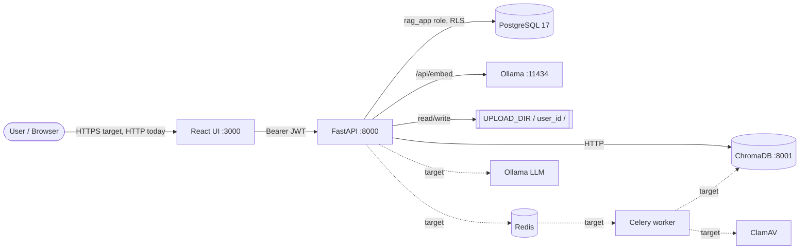

---

## 2. Code map

| Layer | Path | Responsibility |
|---|---|---|
| Routes | `backend/app/api/v1/` | `auth.py`, `users.py`, `documents.py`, `retrieval.py` |
| Auth dependency | `backend/app/api/deps.py` | Decode the JWT, load the user, bind the RLS context |
| Security | `backend/app/core/security.py` | Password hashing (PBKDF2-SHA256), JWT encode/decode |
| Config | `backend/app/core/config.py` | Env settings, DB URLs, secret validation |
| DB session | `backend/app/db/session.py` | Async engine as `rag_app` |
| RLS context | `backend/app/db/rls.py` | `SET LOCAL ROLE rag_app`, `app.user_id`, `app.user_role` |
| Chroma | `backend/app/db/chroma.py` | Public collection, `user_{user_id}_private` collections |
| Vector ops | `backend/app/services/vector_store.py` | Upsert, owner-scoped query, delete |
| Ingest | `backend/app/services/document_ingest.py` | Extract → chunk → embed → upsert, status updates |
| Parsing | `backend/app/services/document_parser.py` | TXT / PDF (PyPDF2) / DOCX (python-docx) |
| Chunking | `backend/app/services/chunking.py` | Fixed-size character chunks (1000, overlap 200) |
| Hashing | `backend/app/services/hash_service.py` | Streaming SHA-256 with a size limit |
| Models | `backend/app/models/` | `User`, `Document` |
| Migrations | `backend/alembic/versions/` | Schema plus RLS |

---

## 3. Request lifecycle: authentication and RLS (as built)

Every protected endpoint goes through `CurrentUser` (`deps.get_current_user`).

```mermaid
sequenceDiagram
    autonumber
    participant C as Client
    participant D as deps.get_current_user
    participant S as security.decode_access_token
    participant DB as PostgreSQL (rag_app)
    participant R as Route handler

    C->>D: Authorization: Bearer <JWT>
    alt missing / not Bearer
        D-->>C: 401 Not authenticated
    end
    D->>S: verify signature, exp, iss, aud, sub=UUID
    alt invalid / expired
        S-->>C: 401
    end
    D->>DB: SELECT user WHERE id=sub AND is_deleted=false
    alt not found
        D-->>C: 401 Unknown or deleted user
    end
    D->>DB: SET LOCAL ROLE rag_app; set_config('app.user_id', uid, true); set_config('app.user_role', role, true)
    Note over D,DB: session.info marks rls_enforced. The after_begin hook re-applies<br/>these settings on every new transaction (e.g. after commit).
    D->>R: current_user
    R->>DB: queries filtered by app code AND RLS policies
    R-->>C: response
```

Key properties:
- The client can never choose an identity: `X-User-Id` is gone, and identity comes only from the JWT `sub`.
- Settings are **transaction-local**, so they can't leak to the next request on a pooled connection (covered by a test).
- A transaction with no `app.user_id` sees **0 rows** in `documents` (it fails closed).

---

## 4. Data flows (as built)

### 4.1 Registration and login

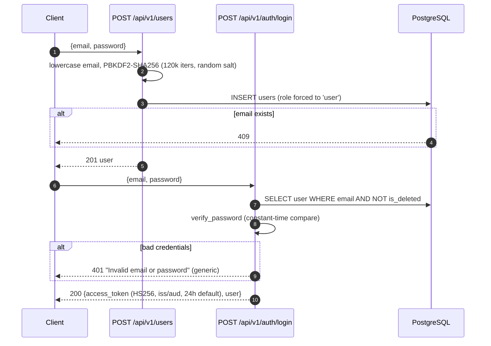

Gaps against the requirements: no name, captcha or password-complexity rules (RQ001); no email verification (RQ002); no lockout or rate limit (RQ003); no refresh token or logout blacklist (RQ004); PBKDF2 is used instead of bcrypt (RQ008); the token lasts 24 hours, while FR-002 asks for 30 minutes.

### 4.2 Document upload and ingestion (synchronous)

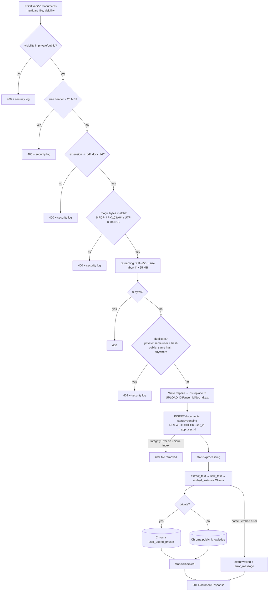

Chunk metadata stored in Chroma: `document_id`, `filename`, `chunk_index`, `user_id` (hex), `visibility`. Chunk IDs: `"{document_id}:{index}"`.

### 4.3 Document status lifecycle

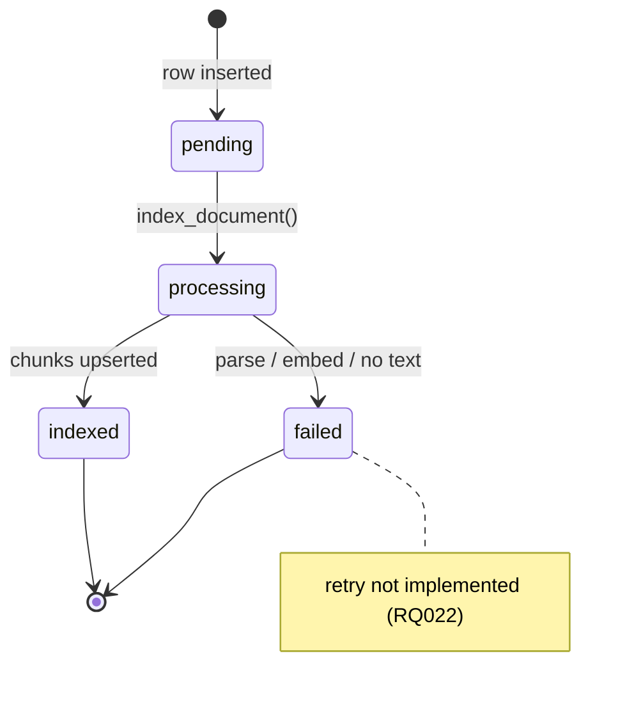

### 4.4 Retrieval (semantic search and PostgreSQL RLS-backed chunk authorization - AL-128)

> **Architectural Clarification on AL-128:**
> The original Jira task AL-128 was titled *"Enable RLS on chunks table"*. In this architecture:
> - ChromaDB stores document chunks, embeddings, and vector metadata; it is a separate vector store and does **not** have a native PostgreSQL Row-Level Security engine.
> - PostgreSQL does **not** have a `chunks` table, avoiding redundant data duplication across two databases.
> - Equivalent secure chunk-level access control is enforced via **PostgreSQL RLS-backed chunk authorization**: ChromaDB retrieves candidate vector hits, and their parent `document_id`s are immediately evaluated against PostgreSQL `documents` under active, transaction-local Row-Level Security (`SET LOCAL ROLE rag_app; app.user_id`).
> - This guarantees that no private chunk is ever returned to an unauthorized user, achieving the security goal of AL-128 through authoritative PostgreSQL governance rather than a literal RLS policy on ChromaDB.

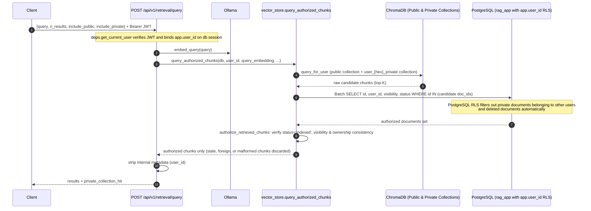

#### Chunk Retrieval Security Principles (AL-128)

1. **Why Chunks are in ChromaDB instead of PostgreSQL:**
   - Vector indexing and HNSW cosine similarity search are delegated to ChromaDB, keeping PostgreSQL focused on ACID transactions, relational integrity, and strict access-control governance.
   - Creating a redundant PostgreSQL `chunks` table is avoided; instead, PostgreSQL document RLS acts as the single source of truth for authorization.

2. **How PostgreSQL Document RLS Protects Chunk Retrieval:**
   - Every user-facing retrieval request runs within an authenticated PostgreSQL transaction configured with `SET LOCAL ROLE rag_app` and `set_config('app.user_id', <user_id>, true)`.
   - When candidate chunks are returned by ChromaDB, their `document_id`s are extracted and verified against PostgreSQL in a single batch query (`SELECT ... WHERE id IN (...)`).
   - PostgreSQL's `documents_select_policy` automatically filters out any private documents not owned by the caller.

3. **Collection Separation & Metadata Filtering:**
   - Public documents reside in the shared collection (`CHROMA_PUBLIC_COLLECTION`).
   - Private documents reside in user-isolated collections (`user_{user_id}_private`).
   - Metadata stamps (`document_id`, `user_id`, `visibility`) are strictly validated; chunks with missing, invalid, or inconsistent metadata are rejected before database validation.

4. **Fail-Closed Authorization:**
   - If PostgreSQL or ChromaDB encounters connection or operational failures, `DatabaseAuthorizationError` or `VectorStoreError` is raised. The endpoint immediately returns HTTP 503 rather than returning unverified or partial data.

5. **Extending to Future Search and Chat Endpoints:**
   - Any future RAG pipeline, LLM chat context builder, or citation generator must call `query_authorized_chunks(db=db, user_id=current_user.id, ...)` rather than invoking ChromaDB directly. This guarantees no unauthorized text or citations reach the client or LLM.

6. **Remaining Limitations:**
   - Deletion from ChromaDB remains best-effort when a document is deleted; however, stale vectors in ChromaDB are guaranteed to be filtered out during retrieval by the PostgreSQL RLS validation step.
   - Access control is currently scoped to the document level (a user either has access to all chunks of an authorized document or none).

There's no BM25, hybrid fusion, re-ranking, threshold or LLM answer yet (RQ024–RQ033).

### 4.5 Delete a document, delete an account

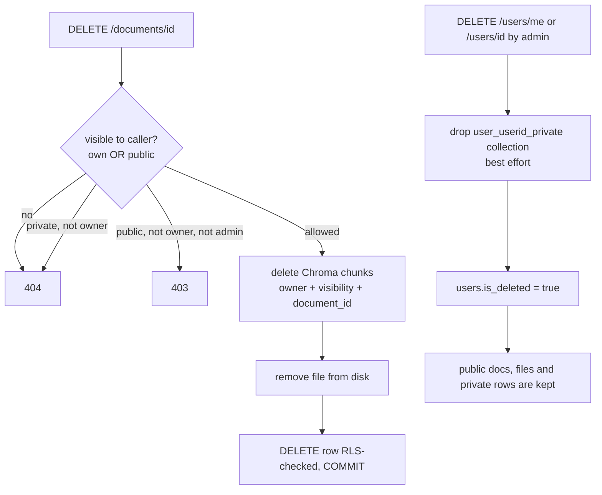

The delete steps aren't atomic: if the commit fails after the vector and file deletes, the data is left inconsistent (RQ012 asks for a transaction). Account deletion leaves the user's private files and rows in place (RQ060).

---

## 5. Database workflow (as built)

### 5.1 Schema

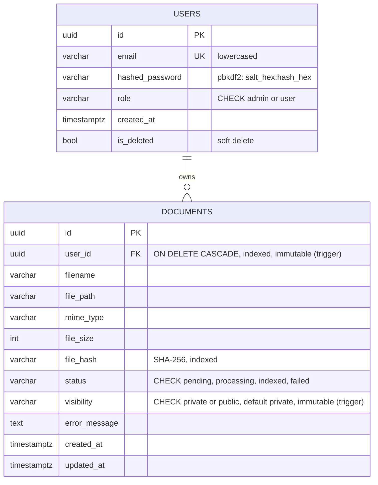

| Index / constraint | Definition | Purpose |
|---|---|---|
| `ix_users_email` | UNIQUE (email) | One account per email |
| `uq_documents_private_user_hash` | UNIQUE (user_id, file_hash) WHERE visibility='private' | Private dedup per user |
| `uq_documents_public_hash` | UNIQUE (file_hash) WHERE visibility='public' | Global public dedup |
| `trg_documents_immutable_owner_and_visibility` | BEFORE UPDATE trigger | Blocks changing `user_id` or `visibility` |

### 5.2 Migration chain

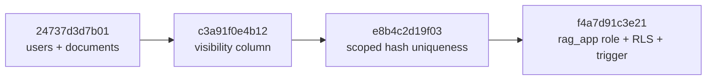

### 5.3 Database roles and connections

| Connection | Setting | Role | Used by |
|---|---|---|---|
| Migrations | `MIGRATION_DATABASE_URL` → falls back to `DATABASE_URL` | `postgres` (superuser) | Alembic, test teardown |
| Runtime | `APP_DATABASE_URL` → derived from `APP_DB_USER/PASSWORD` | `rag_app` | FastAPI, tests |

`rag_app` is `LOGIN NOSUPERUSER NOBYPASSRLS NOINHERIT`. Its grants: `documents`: SELECT, INSERT, UPDATE, DELETE; `users`: SELECT, INSERT, UPDATE (**no DELETE**). Every other table: **no access**.
Outside development, startup refuses the default `SECRET_KEY`, a `postgres` runtime user, or the default app password.

### 5.4 Row-Level Security on `documents` (FORCE RLS)

| Operation | Allowed when (`app.user_id` must be set) |
|---|---|
| SELECT | `visibility='public'` OR (`private` AND `user_id = app.user_id`) |
| INSERT | `user_id = app.user_id` |
| UPDATE | own private doc; public doc if uploader OR `app.user_role='admin'` |
| DELETE | same as UPDATE |

### 5.5 Workflow: adding a new table (required for every Sprint 1+ migration)

1. Add the SQLAlchemy model in `backend/app/models/` and import it in `models/__init__.py`.
2. Run `alembic -c backend/alembic.ini revision --autogenerate -m "..."` and **review** the generated file.
3. In the same migration:
   - `GRANT SELECT, INSERT, UPDATE, DELETE ON TABLE <t> TO rag_app;` (grant only what's needed)
   - `ALTER TABLE <t> ENABLE ROW LEVEL SECURITY; ALTER TABLE <t> FORCE ROW LEVEL SECURITY;`
   - `CREATE POLICY ...` that uses `current_setting('app.user_id', true)`
   - matching `DROP POLICY / REVOKE` in `downgrade()`
4. Run `alembic upgrade head`, then `pytest`. Add a cross-user test (User B gets 0 rows).
5. Without step 3, every request that touches the table fails with **permission denied**.

### 5.6 Vector store layout (ChromaDB)

| Collection | Name | Metadata | Who can read |
|---|---|---|---|
| Public | `CHROMA_PUBLIC_COLLECTION` (`public_knowledge`) | `visibility=public` | Any authenticated user |
| Private | `user_{user_id_hex}_private` | `visibility=private`, `user_id=<hex>` | Owner only. Every read uses `private_owner_filter()` (user_id AND visibility='private') |

Deleting a user drops only their private collection. Public chunks stay.

### 5.7 File storage layout

```
UPLOAD_DIR/                  (default ./uploads, git-ignored)
└── <user_id>/
    └── <document_id>.<ext>  (written via tmp file + atomic os.replace)
```

---

## 6. Target design (from RQ001–RQ060, not built yet)

### 6.1 Target ingestion (RQ014–RQ022, FR-064–FR-067)

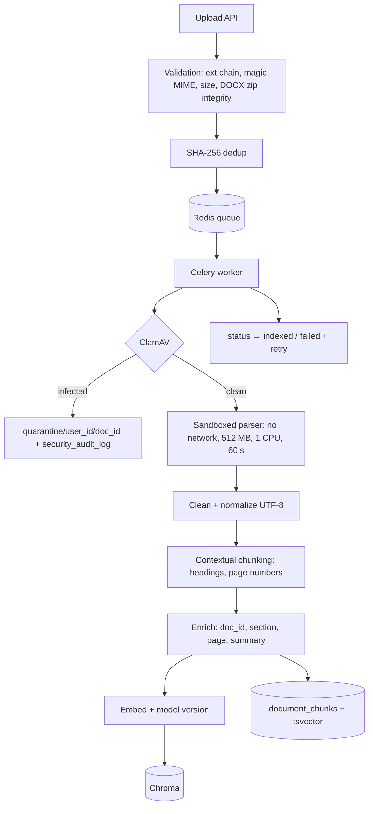

### 6.2 Target question answering (RQ023–RQ049)

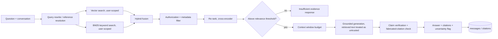

### 6.3 Target schema additions

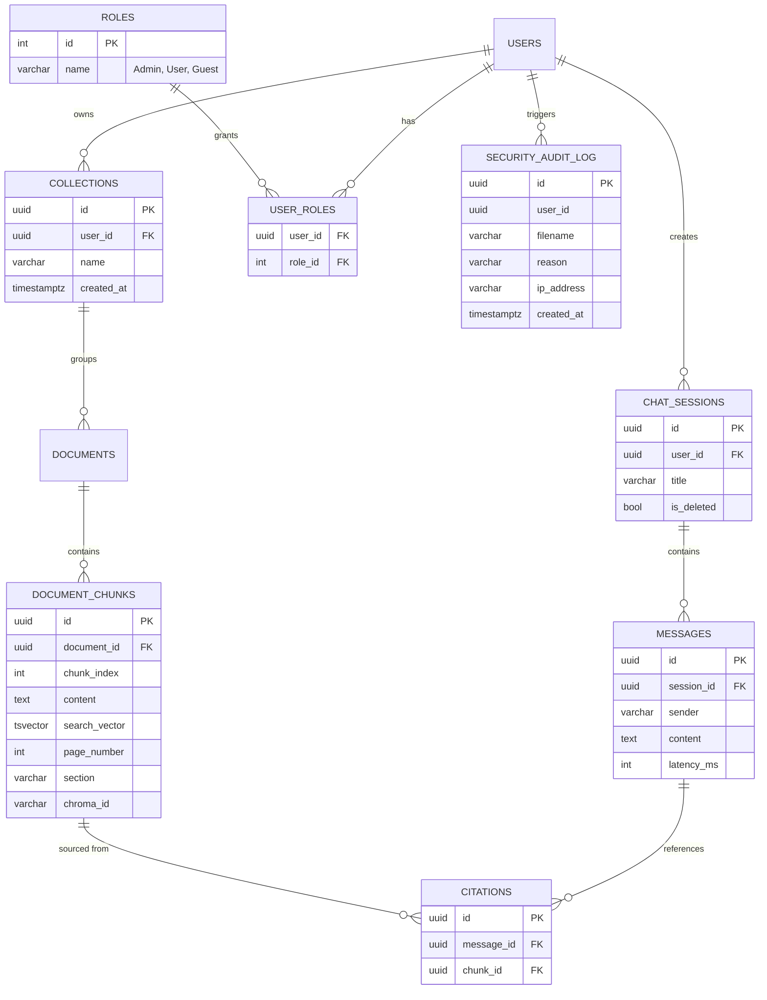

Each of these tables needs the RLS workflow in §5.5. `documents` also needs a `collection_id` FK (FR-012).

---

## 7. Requirements traceability (status on `develop`, Sprint 1)

Legend: ✅ done · 🟡 partial · ❌ not started

| RQ | Requirement | Status | Where / gap |
|---|---|---|---|
| RQ001 | Registration | 🟡 | `POST /users` (email, password ≥ 8, role forced to user). Missing: name, captcha, complexity rules |
| RQ002 | Email verification | ❌ | – |
| RQ003 | Login | 🟡 | `POST /auth/login` JWT. Missing: captcha, 5-try lockout, refresh token |
| RQ004 | Logout | ❌ | No token blacklist (Redis unused) |
| RQ005 | RBAC | 🟡 | `role` admin/user; admin-only list/delete users. Missing: Guest, roles tables, `require_role` |
| RQ006 | Document-level access | ✅ | API scoping + PostgreSQL RLS; TC-ISO-01 test |
| RQ007 | Cross-user isolation | 🟡 | Per-user collections, owner filters, no owner IDs in responses. Conversations don't exist yet |
| RQ008 | Encryption | 🟡 | PBKDF2-SHA256 (not bcrypt); no AES-256 at rest; no TLS |
| RQ009 | Upload | ✅ | PDF/DOCX/TXT, 25 MB, metadata, per-user storage. Collections pending |
| RQ010 | View & download | 🟡 | Metadata `GET /documents/{id}`. **No download endpoint** |
| RQ011 | Update / re-index | ❌ | No `PUT /documents/{id}` |
| RQ012 | Delete cascade | 🟡 | File + row + chunks deleted. Not transactional; no confirmation |
| RQ013 | Collections | ❌ | – |
| RQ014 | File validation | 🟡 | Extension, magic bytes, size, empty. **No DOCX zip integrity (`testzip`) and no python-magic**, though Jira AL-150/AL-152 are Done. No malware scan |
| RQ015 | Text extraction | 🟡 | PyPDF2 / python-docx / TXT. No page or section preservation, no OCR |
| RQ016 | Cleaning | 🟡 | Whitespace collapse only |
| RQ017 | Contextual chunking | 🟡 | Fixed 1000 chars / 200 overlap. No headings or page numbers |
| RQ018 | Chunk enrichment | 🟡 | doc_id, filename, chunk_index. No section, page or summary |
| RQ019 | Embeddings | 🟡 | Ollama `nomic-embed-text`. Model version not stored |
| RQ020 | Vector DB | ✅ | ChromaDB cosine. Latency not measured |
| RQ021 | Automatic indexing | 🟡 | Synchronous during upload. No queue, no re-index |
| RQ022 | Error reporting | 🟡 | `status=failed` + `error_message`. No retry |
| RQ023 | Semantic search | ✅ | `POST /retrieval/query` |
| RQ024 | Keyword (BM25) | ❌ | `rank-bm25` is installed but unused |
| RQ025 | Hybrid retrieval | ❌ | – |
| RQ026 | Retrieval filtering | 🟡 | Authorization filtering done. Metadata filters missing |
| RQ027 | Re-ranking | ❌ | – |
| RQ028 | Relevance threshold | ❌ | – |
| RQ029–RQ035 | Q&A, rewriting, context window, grounding, insufficient evidence, multi-doc | ❌ | No LLM generation endpoint yet |
| RQ036–RQ041 | Conversation memory | ❌ | No chat tables |
| RQ042–RQ044 | Citations, evidence inspection, uncertainty | ❌ | – |
| RQ045 | Citation privacy | 🟡 | Retrieval layer already blocks unauthorized chunks. Citations not built |
| RQ046–RQ049 | Sufficiency, claim verification, fabrication, prompt injection | ❌ | – |
| RQ050–RQ054 | Evaluation metrics | ❌ | – |
| RQ055 | Security testing | 🟡 | 55 automated tests incl. TC-ISO and RLS, run in CI. No penetration test report |
| RQ056 | Scalability | ❌ | No load test |
| RQ057 | Reliability | 🟡 | Docker `restart: unless-stopped`. No monitoring |
| RQ058 | Usability | ❌ | Frontend is a placeholder page |
| RQ059 | Maintainability | 🟡 | Modular layout, CI, this doc. Coverage not measured, logging not centralized |
| RQ060 | Data deletion | 🟡 | Soft delete + private vectors purged. Files and rows kept; no email |

### Mismatches to resolve

1. **Jira says Done, code says otherwise:**
   - AL-150 (python-magic): the code uses a manual magic-byte check, not python-magic.
   - AL-152 (DOCX zip integrity): only the `PK` header is checked, with no `testzip()`.
   - AL-135 (bcrypt cost ≥ 12): the code uses PBKDF2, not bcrypt.
2. **README is out of date:** the ERD shows a global UNIQUE `file_hash` and is missing `visibility`, and it says the head migration is `24737d3d7b01` (it's `f4a7d91c3e21`).
3. **Requirements vs Jira wording:** the collection name was `user_{user_id}_chunks` in FR-006 and `user_{user_id}_private` in FR-079. The code uses `user_{user_id}_private`.
